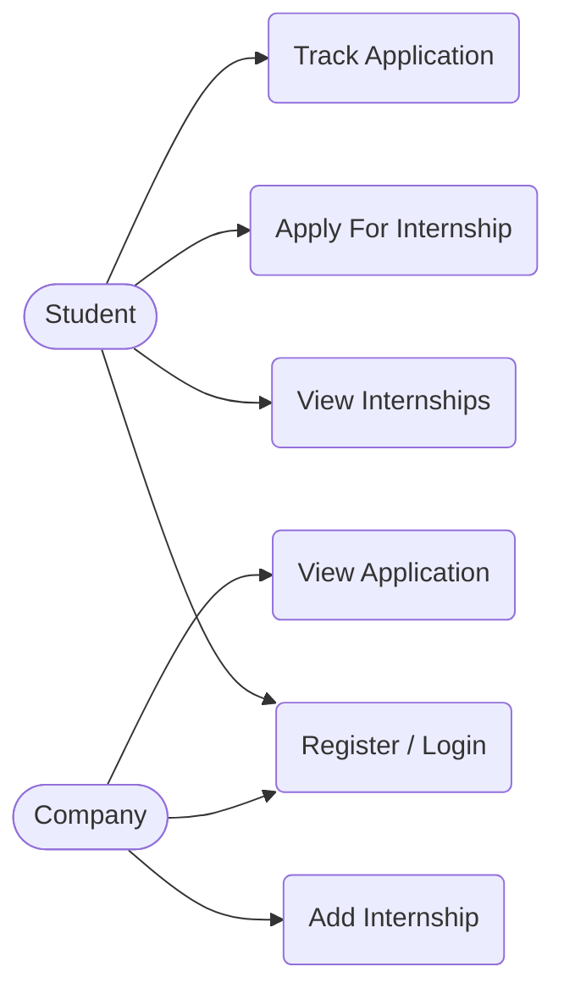

# CareerBridge

A web system that connects university students with internship opportunities. Companies post internships, and students browse them, apply, and follow the status of their applications.

## Overview

Students often struggle to find internships, and companies have no simple channel to reach them. CareerBridge puts both sides in one place: companies publish internships, and students discover them and apply directly.

## Actors

| Actor | Description |
|---|---|
| **Student** | A university student looking for an internship |
| **Company** | The side that posts internships and receives applications (shown as "Application" in the use case diagram) |

## Use Cases



| Use case | Actor | Description |
|---|---|---|
| Register / Login | Student, Company | Create an account and sign in to the system |
| View Internships | Student | Browse the internships posted by companies |
| Apply For Internship | Student | Submit an application to a chosen internship |
| Track Application | Student | Follow the status of submitted applications |
| Add Internship | Company | Publish a new internship opportunity |
| View Application | Company | See the applications received for its internships |

## Features

**Students**
- Create an account and log in.
- Browse available internships.
- Apply for an internship.
- Track the status of every application.

**Companies**
- Create an account and log in.
- Add new internships.
- View the applications submitted to them.

## Typical Flow

1. A company registers, logs in, and adds an internship.
2. A student registers, logs in, and views the available internships.
3. The student applies for an internship.
4. The company views the new application.
5. The student tracks the application from their account.

## Tech Stack

> Fill in the technologies you actually use.

- **Frontend:** _e.g. React / HTML, CSS, JavaScript_
- **Backend:** _e.g. Node.js / Django / Laravel_
- **Database:** _e.g. MySQL / PostgreSQL / MongoDB_

## Getting Started

> Replace the commands below with the ones for your stack.

```bash
# 1. Clone the repository
git clone <your-repo-url>
cd careerbridge

# 2. Install dependencies
# e.g. npm install

# 3. Configure environment variables
# e.g. copy .env.example to .env

# 4. Run the project
# e.g. npm run dev
```

## Roadmap

- [ ] Register / Login for students and companies
- [ ] Add and list internships
- [ ] Apply for an internship
- [ ] Track application status (student)
- [ ] View received applications (company)

## Team

| Name | Role |
|---|---|
| _Name_ | _Role_ |

## License

> Choose a license, for example MIT, and add a `LICENSE` file.
